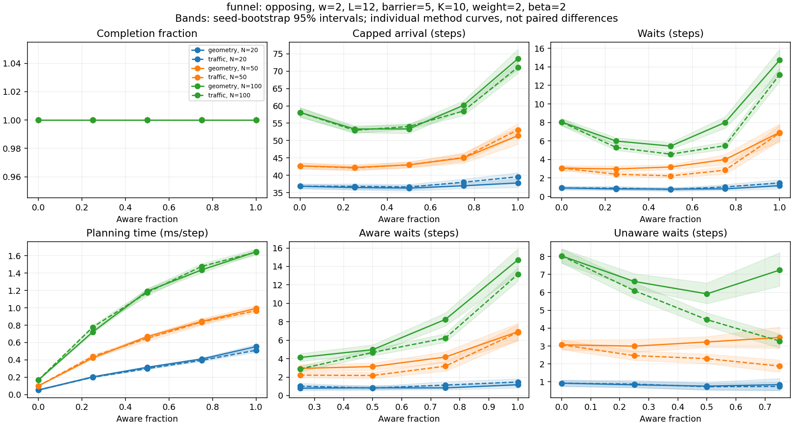
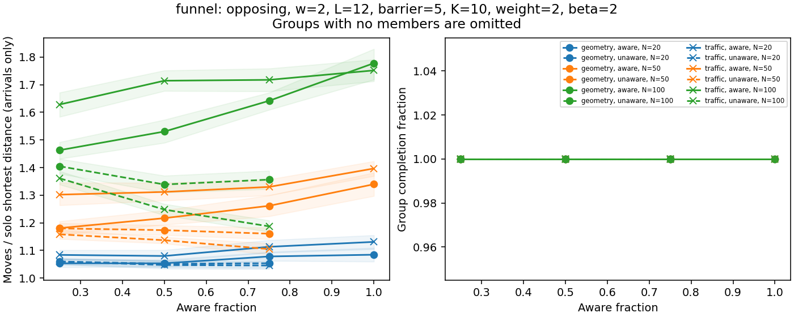
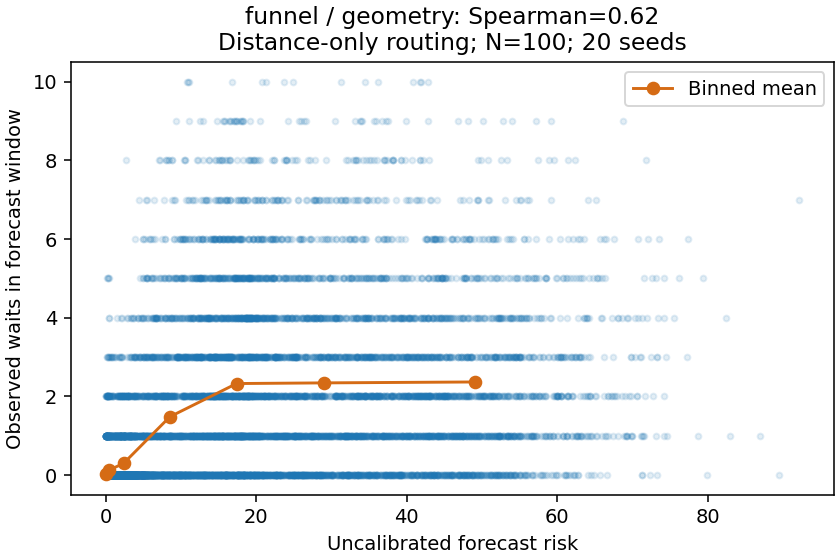
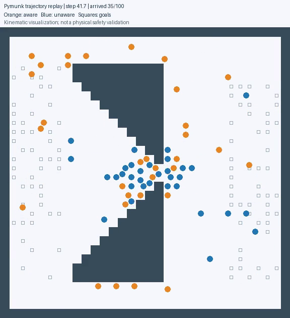

# Crowd Control experiment results

These experiments test how partial use of congestion-aware routing affects group arrival performance. The main finding is conditional: moderate awareness helps in several tested conditions, while universal awareness can worsen arrival time. The score's ability to rank future waiting is a separate question from the routing policy's performance.

## Evidence and scope

| Dataset | Recorded runs | Conditions | Evidence |
| --- | ---: | --- | --- |
| Main study | 2,160 | Four maps; 20/50/100 robots; p=0/.25/.5/.75/1; 20 paired seeds | [Tables and figures](main/) |
| Geometry controls | 270 | N=50, p=.5; width/size/length; one-way/opposing flow; 3 seeds | [Tables and figures](geometry/) |
| Corrected ablations | 72 | Funnel/walls; forecast horizon, congestion weight, counterflow; 3 seeds | [Tables and figures](ablations/) |
| Smoke run | 3 | Funnel, N=20, seed 0, 80-step horizon | [Tables and video](smoke/) |
| Initial ablations, superseded | 84 | Includes 12 redundant runs from integer/float parameter spelling | [Preserved audit evidence](ablations-initial/) |

All **2,589 recorded runs** completed with no collision-validation failure, and every robot arrived within the configured horizon. The initial ablation set is not additional statistical evidence: it contains the same 72 semantic conditions plus 12 duplicates, and overlaps the corrected rerun. Main comparisons use 20 independent scenario seeds per condition; geometry/ablation comparisons use three.

The main, geometry, smoke, and initial-ablation runs use implementation commit `5178a6b`. Corrected ablations use `8b9ea25`, which normalizes numerically equivalent sweep parameters before deduplication; the simulator and planner are unchanged. Exact source SHA-256 hashes, configuration, package versions, and commit IDs are in each dataset manifest and per-run provenance. A dirty worktree flag reflects generated results and report/check-script changes; the simulation source hashes are verified within each archive.

## Main finding at N=100

Mean capped arrival time in steps, averaged over 20 paired seeds. Because all robots arrived, capped arrival equals ordinary arrival time here. The 50% comparison was specified in the plan; it is not presented as an optimized fraction.

| Geometry | Distance-only | Traffic-aware, p=.5 | Geometry-aware, p=.5 | Geometry-aware, p=1 | p=.5 minus baseline, paired 95% interval |
| --- | ---: | ---: | ---: | ---: | --- |
| open | 35.22 | 36.36 | 34.61 | 35.38 | -0.61 [-0.80, -0.41] |
| funnel | 58.12 | 54.06 | 53.37 | 73.60 | -4.75 [-6.06, -3.48] |
| barrier | 37.58 | 38.05 | 36.32 | 39.19 | -1.26 [-1.52, -1.02] |
| walls | 37.14 | 37.91 | 36.30 | 39.30 | -0.84 [-1.12, -0.53] |

- In the funnel at N=100, geometry-aware routing at p=.5 reduces mean arrival by **4.75 steps (8.18%)** relative to distance-only routing. Universal awareness increases it by **15.48 steps (26.64%)**.
- This is not a universal benefit: in the funnel at N=50, p=.5 gives 42.99 versus 42.69 baseline steps; the high-density finding should not be generalized to every density.
- In the N=100 funnel, aware robots at p=.5 have a mean detour ratio of **1.530**, versus **1.339** for unaware robots, while their mean waiting is **0.944 steps lower**. Route burden and waiting benefits differ; these group summaries are descriptive.
- Completion is saturated at 100%. Arrival time, waiting, and detours distinguish these runs; more challenging settings would be needed to establish completion-rate gains.

## Planned summary table at N=50

All rows have 100% completion. Baseline is p=0; aware methods use p=.5. Waiting gap is aware minus unaware; baseline has no aware group. Detours use arrived robots. Planning times are illustrative local wall-clock measurements, not a controlled hardware benchmark.

| Geometry | Method | Arrival steps | Wait gap | Detour ratio | Planning ms/step |
| --- | --- | ---: | ---: | ---: | ---: |
| open | distance | 33.13 | — | 1.039 | 0.109 |
| open | traffic | 33.51 | +0.104 | 1.052 | 0.735 |
| open | geometry | 32.66 | -0.018 | 1.026 | 0.720 |
| funnel | distance | 42.69 | — | 1.192 | 0.099 |
| funnel | traffic | 43.03 | -0.120 | 1.224 | 0.646 |
| funnel | geometry | 42.99 | -0.086 | 1.195 | 0.668 |
| barrier | distance | 34.51 | — | 1.072 | 0.103 |
| barrier | traffic | 34.79 | +0.212 | 1.086 | 0.710 |
| barrier | geometry | 33.70 | +0.000 | 1.051 | 0.725 |
| walls | distance | 34.40 | — | 1.076 | 0.105 |
| walls | traffic | 34.33 | +0.238 | 1.078 | 0.725 |
| walls | geometry | 33.57 | -0.030 | 1.054 | 0.712 |

Full metrics and intervals: [aggregate table](main/aggregate.csv), [paired differences](main/paired_differences.csv), [all individual runs](main/summary.csv).

## Does the congestion score predict waiting?

Passive diagnostics are computed only during distance-only routing, so avoidance cannot erase the outcome being predicted. Forecast risk is compared with actual waiting over non-overlapping 10-step windows, ending at arrival. The scores remain uncalibrated; correlations assess ordering, not accuracy in seconds.

| Geometry, N=100 | Traffic score Spearman | Geometry score Spearman | Geometry score 95% interval |
| --- | ---: | ---: | --- |
| open | 0.310 | 0.298 | [0.276, 0.324] |
| funnel | 0.639 | 0.622 | [0.613, 0.632] |
| barrier | 0.416 | 0.407 | [0.383, 0.430] |
| walls | 0.336 | 0.326 | [0.306, 0.349] |

- The geometry score ranks waiting moderately in the funnel and less strongly in other layouts. This answers the obstacle-sensitivity question empirically rather than assuming one predictor works equally well everywhere.
- Width correction does **not** improve passive rank correlation in these N=100 comparisons, despite sometimes improving routing. A weaker effective penalty or altered route allocation could explain this; these experiments do not establish the causal mechanism.
- Passive accuracy is measured under the baseline policy. It cannot alone explain closed-loop behavior after the routing policy changes.

See [all prediction statistics](main/prediction_summary.csv) and [all figures](main/figures/). Performance intervals use 2,000 seed-bootstrap resamples; correlation intervals use 500 whole-seed resamples. Many comparisons are exploratory and no multiple-comparison correction is applied.

## Geometry controls and ablations

- With opposing flow, N=50 and p=.5, the geometry-aware funnel mean arrival is **48.75, 43.35, and 38.31 steps** for openings of 1, 2, and 4 cells respectively (three seeds each).
- Isolated-barrier sizes 3, 5, and 7 give **32.77, 33.25, and 33.68 steps** under the same population, policy, and direction. Corridor results are retained for every width/length and traffic direction, not selected for a favorable trend.
- In the three-seed funnel ablation, forecast horizons 5, 10, and 20 give **41.81, 43.35, and 42.56 steps**. Stronger or longer prediction is not automatically better. No parameters were retuned on the main-study seeds.
- These controls change geometry and therefore can change route lengths and free space as well as congestion. They diagnose sensitivity; they do not isolate a pure geometry effect at exactly matched density and bypass cost.
- The initial ablation sweep treated `2` and `2.0` as different configuration keys. A regression check now prevents this. Its 84 rows are preserved for audit only; use the corrected 72-run set for interpretation.

## Pymunk replay videos

All main videos use **N=100, seed 0** as a fixed demonstration scenario; they are not claimed to represent typical or best-case outcomes. They run to the end of the logged simulation. Orange is aware; blue is unaware. Each MP4 has been decoded after rendering, and its PNG is a midpoint thumbnail.

| Replay | MP4 | Thumbnail |
| --- | --- | --- |
| open, geometry, p=0.5 | [Video](main/videos/open-geometry-n100-p0.5-seed0.mp4) | [Image](main/videos/open-geometry-n100-p0.5-seed0.png) |
| funnel, geometry, p=0.5 | [Video](main/videos/funnel-geometry-n100-p0.5-seed0.mp4) | [Image](main/videos/funnel-geometry-n100-p0.5-seed0.png) |
| barrier, geometry, p=0.5 | [Video](main/videos/barrier-geometry-n100-p0.5-seed0.mp4) | [Image](main/videos/barrier-geometry-n100-p0.5-seed0.png) |
| walls, geometry, p=0.5 | [Video](main/videos/walls-geometry-n100-p0.5-seed0.mp4) | [Image](main/videos/walls-geometry-n100-p0.5-seed0.png) |
| funnel, distance, p=0 | [Video](main/videos/funnel-distance-n100-p0-seed0.mp4) | [Image](main/videos/funnel-distance-n100-p0-seed0.png) |
| funnel, geometry, p=1 | [Video](main/videos/funnel-geometry-n100-p1-seed0.mp4) | [Image](main/videos/funnel-geometry-n100-p1-seed0.png) |

These are Pymunk **kinematic replays** of discrete plans, not tests of continuous robot dynamics, acceleration limits, or physical collision avoidance. The smoke-run video is retained [here](smoke/videos/funnel-geometry.mp4).

## Reproduce and inspect

1. Follow [the study guide](../docs/CROWD_STUDY.md). Run configurations are copied into each dataset as `specification.json`.
2. For exact historical reproduction, use the source commit from the dataset manifest. The later normalization fix changes run IDs for integer-valued parameters, but not trajectories or costs.
3. Raw per-run CSVs, configuration, provenance, and compressed trajectories are in `raw_runs.tar.gz`. From a dataset directory, unpack with `tar -xzf raw_runs.tar.gz` to restore `runs/`, then use `crowd-study plot` or `crowd-study replay`.
4. `python scripts/verify_results.py` verifies artifact hashes, raw/summary agreement, source hashes, robot counts, and per-robot step accounting. CI runs this in addition to the 17 tests.
5. Setup and passive diagnostic time are separate from per-step planning time. Sweeps execute serially; ordinary system load and a brief overlap with smoke visualization were not controlled. Treat runtime as an implementation-cost indicator, not a benchmark ranking.

## Limits and next decisions

- Results cover synthetic maps and globally shared intentions. They do not establish performance with noisy sensing, decentralized communication, or physical robots.
- All conditions complete, so tougher traffic or constrained bypasses are needed to study failure rates. Do not extrapolate the observed arrival gains to arbitrary layouts.
- A small clearance penalty is only one geometry model. The mixed prediction/routing findings motivate queue-length or corridor-length features, evaluated on held-out layouts.
- The study supports testing partial awareness and reporting both group benefit and individual detours. It does not establish a universally optimal awareness fraction or a new state-of-the-art planner.
